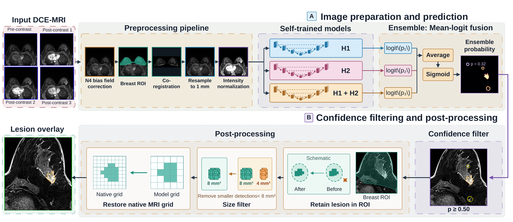

# Breast MRI lesion segmentation with confidence-filtered self-training

A four-channel breast DCE-MRI workflow for preparing examinations, training a source nnU-Net, adapting it with fixed binary pseudo-labels, and combining three hospital models at inference. The preprocessing modules are adapted from the study scripts. The training and inference entry points are a reference implementation for running the method with your own data and weights.

*Figure 1. Breast DCE-MRI lesion segmentation at inference. Panel A shows image preparation, model predictions and mean-logit fusion. Panel B follows the fused prediction through thresholding and post-processing to the lesion overlay on the native MRI grid.*

## Installation

Use Linux and Python 3.12. Install the file utility and the dcm2niix executable if starting from DICOM. DCMTK supplies the optional dcmdump executable used to read series descriptions. Activate a Python environment with a PyTorch build supported by your GPU driver. Python dependency versions are pinned in requirements.txt.

~~~bash
python3.12 -m venv .venv
source .venv/bin/activate
python -m pip install -r requirements.txt
python -c "import ants, nibabel, SimpleITK, torch; print(torch.__version__, torch.cuda.is_available())"
~~~

Run all commands from the repository root. Edit paths and settings directly near the top of each entry point. Local working files go under `work/`. Model files, raw medical images, sidecars, logs and generated case previews are excluded from version control. Use de-identified copies in a local workspace. The conversion step derives filenames from DICOM fields and is not a de-identification tool.

## 1. Prepare four DCE channels

~~~bash
python preprocess.py
~~~

Set DICOM_INPUT_DIR, CONVERTED_DIR, SELECTED_DCE_DIR, PREPROCESSED_DIR, and BREAST_MASK_DIR in preprocess.py. RUN_STAGES selects the stages to execute in order. For example, use (5, 6) when starting with four selected NIfTI volumes per case. This avoids the original acquisition-specific DICOM routing. Input names must end in _0000 through _0003 with a .nii or .nii.gz extension. The modelling scripts use .nii.gz. Channel 0 is pre-contrast and channels 1–3 are three selected post-contrast acquisitions in chronological order.

| Stage | Source in preprocessing/ | Operation |
|---|---|---|
| 1 | conversion.py | Convert each eligible DICOM series with dcm2niix. Configure the expected directory depth and minimum file count for your export. |
| 2 | rename_series.py | Group the converted series under a common examination folder. Run against the converted working copy. |
| 3 | split_timepoints.py | Split supported collated 4D DCE sequences into 3D time points and update the timing sidecars. The default retains the original 4D input. |
| 4 | select_frames.py | Select one pre-contrast and three post-contrast phases and write four numbered NIfTI channels. |
| 5 | mri_preprocessing.py | Apply shared N4 correction, estimate the breast ROI, register the first three phases to the fourth, resample to 1 mm isotropic spacing and normalize the stack. |
| 6 | breast_roi.py | Write an examination-level binary breast ROI on the processed image grid. The original fourth volume provides the anatomical reference. |

Stages 3 and 4 retain the study's two acquisition naming conventions. Check PATIENT_DIR_PATTERN, DCE_PATTERN, PROCESS_PREFIXES and PREFIX_CONFIG before trying another scanner export. One rule selects zero-based indices [0, 2, 5, 7] when all four are available. The other selects frames according to the available count. Inspect the selected frame times for your acquisition. The digits used in filenames are routing conventions and should not be used to infer hospital membership.

For independent use, the shared N4 algorithm is in bias_correction.py, ANTs registration in registration.py, spacing conversion in resampling.py, and stack-wide intensity normalization in normalization.py. The standalone ROI exporter also runs as `python -m preprocessing.breast_roi` after setting its input, output and raw reference paths. For other individual stages, set RUN_STAGES to a one-element tuple, for example (4,), and use preprocess.py so the stage receives the same settings as a full run.

## 2. Pretrain the source model

Prepare a local nnU-Net dataset of labelled breast examinations. The following paths show the naming convention with a fictional case. Keep all examinations from the same patient in the same partition.

~~~text
work/nnUNet_raw/Dataset501_BreastDCE/
  imagesTr/example_0000.nii.gz
  imagesTr/example_0001.nii.gz
  imagesTr/example_0002.nii.gz
  imagesTr/example_0003.nii.gz
  labelsTr/example.nii.gz
~~~

The label is a 3D integer image on the channel grid, with 0 for background and 1 for lesion. Preprocess expert masks onto that grid with nearest-neighbour interpolation if necessary. Obtain any source data under the dataset provider's own access conditions.

~~~bash
python pretrain.py
~~~

The entry point writes dataset.json, checks dataset integrity, plans the full-resolution 3D configuration and runs the configured fold. By default the nnU-Net trainer uses supervised Dice and cross-entropy. Dataset planning derives patch size and batch size from the local data and available training configuration. Archive the resulting plans.json, dataset.json, splits_final.json, environment and training logs alongside your own experiment. Use study.py to point subsequent stages to the trained source model and fold. The inference code expects a two-class softmax model with SimpleITKIO.

## 3. Self-train M1, M2 and M3

For each model, place prepared four-channel examinations in work/adaptation/M1/train/ and work/adaptation/M1/validation/. Supply their binary breast masks in work/adaptation/M1/roi/ as example_mask.nii.gz. Use the same layout for M2 and M3. Assign M1 the first site's training and validation subsets, M2 the second site's, and M3 the pooled subsets. Preserve patient-level separation among training, validation and evaluation, including when pooling sites.

~~~bash
python self_train.py
~~~

Set MODEL_NAME in self_train.py and run once per model. Each run starts from the same configured source weights. It generates fixed binary targets from lesion probabilities of at least 0.70 within the breast ROI after two iterations of dilation. No expert evaluation mask is used in this step. The source nnU-Net preprocessor transforms channels and pseudo-labels together. The adaptation loop samples one training patch per examination per epoch and uses fixed central patches for validation. The source plan determines the patch shape. This implementation uses AdamW, a five-epoch warm-up to 1e-5, cosine decay and early stopping. Record the seed and training membership for each run. The selected weights and plans are saved locally in work/models/M1, M2 or M3. Each output directory must be new.

## 4. Predict with one model or the ensemble

~~~bash
python inference.py
python ensemble.py
~~~

For single-model inference, set INPUT, MODEL, FOLD, WEIGHTS and OUTPUT in inference.py. INPUT contains four channels per examination. The default predicts with the source baseline. Each output is a 3D lesion probability image on the prepared input grid. To evaluate an adapted model, select its local model directory and fold 0.

For ensemble inference, ensemble.py loads the three local model directories and predicts on the same examinations. Under work/evaluation/, supply images/ with the four prepared channels, roi/example_mask.nii.gz on the prepared grid, and native/example.nii.gz as the original fourth-phase reference. Native and prepared images must share the physical coordinate system. The code averages voxel-wise lesion log-odds with equal weights, converts back to probability and thresholds at 0.50. It keeps six-connected components with at least 1% overlap with the dilated ROI and volume of at least 8 mm³. It maps the mask to native space with nearest-neighbour interpolation and reapplies the volume cutoff. Outputs are a probability image on the prepared grid and a binary mask on the native reference grid.

## Results reported in the manuscript

The comparison included 20 examinations, ten from each hospital. These are manuscript results. The public code does not include the original hospital images, annotations, study splits or trained weights. Running the reference training workflow on other data produces a new experiment.

| Model | Overall mean Dice | Hospital 1 | Hospital 2 |
|---|---:|---:|---:|
| Source baseline | 0.3637 | 0.3835 | 0.3440 |
| M1 | 0.4190 | 0.4626 | 0.3754 |
| M2 | 0.3667 | 0.3922 | 0.3412 |
| M3 | 0.4128 | 0.4496 | 0.3760 |
| Equal-weight ensemble | 0.4382 | 0.4627 | 0.4137 |

The archived models behind the headline ensemble score used Dice and cross-entropy. The fixed-target focal Tversky workflow in self_train.py represents a separate training configuration. The training provenance available for this release does not establish that running self_train.py reproduces the headline model weights.

## Citation

> Neel Kanwal, Matthan Caan and Oliver Marcel Geier. *Self-Training with Confidence-Filtered Pseudo-Labels for Domain-Adapted Breast MRI Lesion Segmentation*. Unpublished manuscript.

Publication details and DOI can be added here when available.

Contact: Neel Kanwal (neel.kanwal0@gmail.com).
